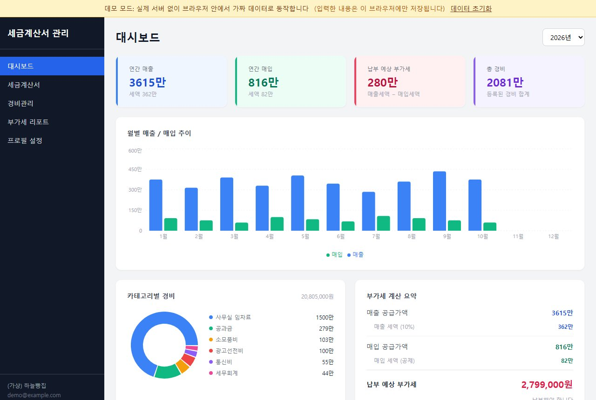
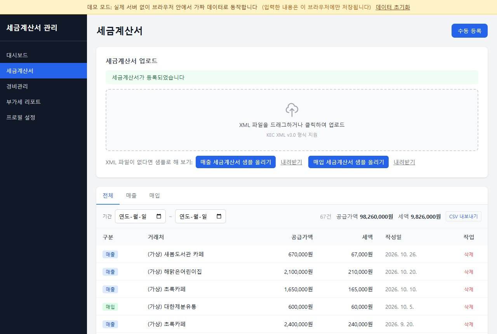
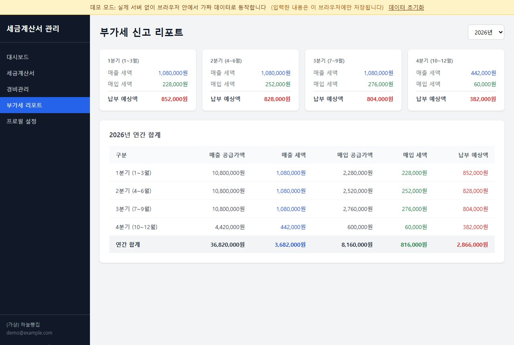

# 세금계산서 자동 정리

> 🔗 **Live Demo**: https://frontend-gamma-ten-19.vercel.app

작은 가게 사장님이 받은 세금계산서와 쓴 경비를 한곳에 모아, 이번 분기에 부가세가 얼마쯤 나올지 미리 보여 주는 웹 앱입니다.

**바로 써 보기: https://yeomhojun1.github.io/tax-automation/**

## 이게 뭔가요

가게 장부를 대신 정리해 주는 디지털 서랍이라고 생각하면 됩니다. 홈택스에서 내려받은 세금계산서 파일을 넣으면 누구에게 팔았는지(매출), 누구에게서 샀는지(매입)를 알아서 나눠 담고, 서랍을 열면 월별 합계와 내야 할 부가세 예상액이 바로 보입니다. 월세·전기요금 같은 경비도 같은 서랍에 적어 둘 수 있습니다.

## 이런 분께 필요해요

- 분기마다 부가세 신고 전에 홈택스 세금계산서를 하나씩 열어 엑셀에 옮겨 적고, 매출세액과 매입세액을 손으로 더하는 가게 사장님
- 세무사에게 자료를 넘기기 전까지는 이번에 세금이 얼마나 나올지 짐작하기 어려워, 신고 시기가 되면 목돈 걱정부터 하는 1인 사업자
- 카드 영수증·공과금 같은 경비를 메모장이나 수첩에 따로 적어 두다가, 연말에 항목별 합계를 다시 계산하는 분

## 화면으로 보기



대시보드입니다. 가상의 빵집 '(가상) 하늘빵집'의 올해 매출·매입·경비 합계, 월별 매출/매입 막대그래프, 경비 항목별 비율, 납부 예상 부가세(매출세액 − 매입세액)가 한 화면에 모입니다.



세금계산서 화면입니다. "매출 세금계산서 샘플 올리기"를 누르면 샘플 XML 파일이 올라가고, 맨 위에 "세금계산서가 등록되었습니다"가 뜨며 목록 첫 줄에 새 거래처가 매출로 추가됩니다. 목록은 전체/매출/매입 탭과 기간으로 거를 수 있습니다.



부가세 리포트 화면입니다. 1~4분기마다 매출세액, 매입세액, 납부 예상액을 나눠 보여 주고, 아래 표에 연간 합계를 냅니다.

(세 화면 모두 공개 데모 사이트에서 2026-10-26에 찍었습니다. 데모 데이터는 접속한 날짜를 기준으로 만들어지므로 숫자는 날마다 조금씩 다릅니다.)

## 바로 써 보기

**https://yeomhojun1.github.io/tax-automation/**

- 설치나 회원가입이 필요 없습니다. 브라우저로 위 주소를 열면 됩니다.
- 데모는 실제 서버 없이 브라우저 안에서 가짜 데이터로 움직입니다. 입력한 내용은 내 브라우저에만 저장되고 다른 곳으로 전송되지 않습니다.
- 데모 계정: 로그인 화면의 **"데모 계정으로 바로 시작"** 버튼을 누르거나, 이메일 `demo@example.com` / 비밀번호 `demo1234`를 직접 입력합니다.

체험 순서

1. 로그인 화면에서 "데모 계정으로 바로 시작"을 누릅니다. 가상 빵집 '(가상) 하늘빵집'의 작년 1월부터 이번 달까지 매출·매입 세금계산서와 경비가 미리 들어 있습니다.
2. **대시보드**에서 올해 매출, 매입, 납부 예상 부가세, 총 경비를 확인합니다. 오른쪽 위에서 연도를 바꾸면 작년 숫자도 볼 수 있습니다.
3. 왼쪽 메뉴 **세금계산서**로 가서 "매출 세금계산서 샘플 올리기"를 누릅니다. 목록에 한 건이 늘어납니다. 같은 버튼을 한 번 더 누르면 "이미 등록된 세금계산서입니다"라는 안내가 나오고 두 번 저장되지 않습니다. "내려받기"로 샘플 파일을 받은 뒤 업로드 칸에 직접 끌어다 놓아도 됩니다.
4. **경비관리**에서 경비를 하나 적어 보고, 검색·수정·삭제와 "CSV 내보내기"(엑셀에서 열리는 파일)를 눌러 봅니다.
5. **부가세 리포트**에서 방금 올린 세금계산서가 해당 분기 납부 예상액에 더해졌는지 확인합니다.
6. 처음 상태로 돌리려면 화면 맨 위 노란 띠의 "데이터 초기화"를 누릅니다.

## 할 수 있는 것

- **세금계산서 파일 올리기**: 홈택스 전자세금계산서 XML 파일을 올리면 거래처, 금액, 품목, 날짜를 읽어 매출과 매입으로 나눠 저장합니다.
- **같은 계산서 두 번 저장 막기**: 이미 올린 계산서를 다시 올리면 거절합니다.
- **파일 없이 직접 적기**: 종이 계산서처럼 파일이 없는 건은 "수동 등록"으로 입력합니다. 공급가액을 넣으면 세액(10%)이 자동으로 채워집니다.
- **경비 기록**: 임차료, 공과금, 소모품비 등 14개 항목으로 경비를 적고, 검색·수정·삭제합니다.
- **한눈에 보는 대시보드**: 연간 매출·매입·경비 합계, 월별 그래프, 항목별 경비 비율, 납부 예상 부가세를 보여 줍니다.
- **분기별 부가세 리포트**: 분기마다 매출세액에서 매입세액을 뺀 예상 납부액(음수면 환급 예상)을 보여 줍니다.
- **신고 마감 알림**: 부가세 확정신고 마감(1월 25일, 7월 25일) 30일 전부터 화면 위에 남은 날짜를 띄우고, 7일 이내면 빨간색으로 바꿉니다.
- **엑셀로 내보내기**: 세금계산서 목록과 경비 목록을 엑셀에서 한글이 깨지지 않는 CSV 파일로 내려받습니다.

## 어떻게 동작하나요

**전자세금계산서 XML 파일**은 홈택스에서 발급된 세금계산서 한 장의 내용(누가, 누구에게, 언제, 무엇을, 얼마에 팔았는지)을 컴퓨터가 읽을 수 있는 정해진 양식으로 적어 둔 파일입니다. 홈택스에서 내려받을 수 있습니다.

파일을 올리면 다음 순서로 정리합니다.

1. **읽기**: 파일에서 국세청 승인번호, 작성일자, 계산서 종류(과세·영세율·면세 등), 파는 쪽과 사는 쪽의 상호·사업자등록번호, 공급가액과 세액, 품목별 수량·단가를 꺼냅니다.
2. **매출/매입 나누기**: 파는 쪽 사업자등록번호가 내 가게 번호와 같으면 내가 판 것이므로 '매출', 아니면 내가 산 것이므로 '매입'으로 분류합니다. 거래처 이름도 상대방 쪽에서 가져옵니다.
3. **이상한 파일 걸러내기**: 승인번호가 없거나, 날짜가 실제로 없는 날(예: 13월 45일)이거나, 금액이 숫자가 아니면 저장하지 않고 이유를 알려 줍니다. `1,000,000`처럼 쉼표가 들어간 금액은 숫자로 바꿔 읽습니다.
4. **중복 확인**: 같은 승인번호를 이미 올렸으면 거절합니다. 판 사람과 산 사람이 각자 같은 계산서를 올리는 것은 정상이므로, 중복 여부는 사용자별로 따로 판단합니다.
5. **합계 내기**: 저장된 계산서를 날짜로 묶어 월별·분기별 합계를 내고, `매출세액 − 매입세액`으로 납부 예상 부가세를 계산합니다.

데모 사이트에서는 이 과정이 모두 브라우저 안에서 일어납니다. 실제 서버용 코드(백엔드)에도 같은 규칙의 파서가 있고, 데모용 파서는 그 규칙을 브라우저에서 그대로 따라 하도록 따로 만들었습니다.

## 어떻게 만들었나요

- **AI 코딩 에이전트로 제작**: 화면(React)과 서버(NestJS)를 AI 코딩 에이전트로 만들었습니다.
- **테스트 에이전트로 점검**: 별도 에이전트에게 기능 46개를 실제로 실행해 보게 했습니다. 결과는 통과 36, 실패 2, 환경 부족으로 확인 못 함 6, 해당 없음 2였고, 이 과정에서 버그 12건이 나왔습니다([feature-test-report.md](feature-test-report.md)). 가장 큰 문제는 "판 사람이 올린 세금계산서를 산 사람이 같은 파일로 올리면 서버 오류가 난다"는 것이었습니다. 실제로 쓰면 바로 부딪혔을 문제입니다.
- **고치고 다시 확인**: 12건과 문서 불일치를 고친 뒤, 기존에 0개였던 자동 테스트를 21개 추가해 모두 통과시켰고, 실제 서버 코드를 띄워 요청을 보내는 점검 33항목도 모두 통과했습니다([fix-report.md](fix-report.md)). 다만 이 점검은 데이터베이스를 메모리 속 가짜로 바꿔 돌린 것이고, 실제 PostgreSQL에서 돌리는 확인은 보고서 작성 시점에 보류 상태였습니다.
- **데모 모드 추가**: 서버와 데이터베이스가 없어도 누구나 눌러 볼 수 있도록, 브라우저 안에서 가짜 서버처럼 응답하는 데모 모드와 가상 빵집 데이터를 넣고 GitHub Pages에 올렸습니다. 데모 모드는 별도로 빌드할 때만 켜지고, 일반 빌드에는 들어가지 않습니다.

## 아직 부족한 점

- **실제 사용자는 없습니다.** 공개된 것은 가상 데이터로 움직이는 데모뿐이고, 실제 가게에서 써 본 적은 없습니다.
- **데모 데이터는 지어낸 것입니다.** '(가상) 하늘빵집'과 거래처 이름, 사업자등록번호는 모두 가짜입니다.
- **좁은 화면에서 깨집니다.** 왼쪽 메뉴 폭이 고정이라 휴대폰 너비(390px)에서는 본문이 좁아져 제목과 숫자가 한 글자씩 세로로 쌓입니다. 지금은 PC 화면 기준입니다.
- **홈택스와 자동 연결되지 않습니다.** XML 파일은 사용자가 홈택스에서 직접 내려받아 올려야 합니다.
- **부가세 계산은 단순합니다.** 일반과세자 기준 `매출세액 − 매입세액`만 계산합니다. 간이과세자의 업종별 계산 방식, 각종 공제·가산세는 반영하지 않으므로 실제 신고액과 다를 수 있습니다.
- **알림은 화면 안 배너뿐입니다.** 문자·메일 알림은 없고, 4월·10월 예정신고 마감은 알림에 들어 있지 않습니다.
- **영수증 사진·PDF 올리기, 결제 기능은 없습니다.** 관련 라이브러리와 설정 칸만 코드에 남아 있고 실제로 쓰는 곳은 없습니다.
- **실제 서버 운영은 검증 전입니다.** 실제 데이터베이스(PostgreSQL)와 파일 저장소(MinIO)를 붙인 상태의 전체 동작 확인은 아직 하지 않았습니다.

## 개발자용 정보

### 데모 모드 빌드

`cd frontend && npm run build:demo` (또는 환경변수 `VITE_DEMO=true`로 `npm run build`). axios 요청을 `frontend/src/demo/mockAdapter.ts`가 브라우저 안에서 처리하고 데이터는 localStorage에 저장합니다. 이 값이 없으면 기존처럼 실제 백엔드를 호출하며, 데모 코드는 번들에 포함되지 않습니다. `master`에 push하면 `.github/workflows/pages.yml`이 데모 빌드를 GitHub Pages에 배포합니다.

### 개요 (세금 자동화 — 소상공인 세금계산서 & 경비처리 플랫폼)

1인 사업자를 위한 세금계산서 관리와 경비처리 자동화 SaaS(계획)입니다. 현재는 공개 데모만 있고 서비스로 운영하지 않습니다.  
홈택스 XML 세금계산서 업로드, 경비 등록, 부가세 신고 D-day 알림까지 한 곳에서 처리합니다.

---

### 주요 기능

| 기능 | 설명 |
|------|------|
| 세금계산서 관리 | 홈택스 XML 업로드 / 수동 등록 / 매출·매입 분류 |
| 경비 관리 | 카테고리별 경비 등록·수정·삭제 / 키워드 검색 |
| 대시보드 | 분기별 매출·매입·경비 현황 한눈에 확인 |
| 부가세 D-day 알림 | 신고 마감 30일 전부터 배너 표시 (일반·간이과세자 구분) |
| CSV 내보내기 | 경비·세금계산서 데이터 엑셀 호환 CSV 다운로드 |
| 비밀번호 변경 | 프로필 페이지에서 안전하게 변경 |

---

### 기술 스택

#### Frontend


#### Backend


#### Infra


---

### 프로젝트 구조

```
tax-app/
├── backend/
│   └── src/
│       ├── auth/           # JWT 인증, 로그인/회원가입, 비밀번호 변경
│       ├── expenses/       # 경비 CRUD, 키워드 검색
│       ├── tax-invoices/   # 세금계산서 업로드·파싱·수동 등록
│       ├── dashboard/      # 분기별 통계 집계
│       └── common/         # 가드, 인터셉터, 필터
├── frontend/
│   └── src/
│       ├── pages/          # 라우팅 단위 페이지
│       ├── components/     # 재사용 컴포넌트
│       ├── api/            # axios 클라이언트 & API 함수
│       ├── store/          # Zustand 전역 상태
│       ├── utils/          # CSV 내보내기 등 유틸
│       └── types/          # 공유 TypeScript 타입
└── docker-compose.yml
```

---

### 시작하기

#### 요구사항
- Node.js 18+ (20 LTS 이상 권장)
- PostgreSQL 16 (로컬 설치, 기본 포트 5432)
- MinIO (선택) — XML 원본 파일 저장용. 없어도 서버는 뜨고 업로드만 실패합니다.

#### 1) 데이터베이스 준비 (네이티브 PostgreSQL)

PostgreSQL 16을 설치한 뒤 `taxdb` 데이터베이스를 만듭니다. 테이블은 `synchronize: true`(비프로덕션)로 서버 기동 시 자동 생성됩니다.

```bash
# psql 로 접속해서 DB 생성 (Windows: SQL Shell 또는 psql -U postgres)
psql -U postgres -c "CREATE DATABASE taxdb;"
```

#### 2) 환경변수 설정

```bash
# backend/.env
cp backend/.env.example backend/.env
```

```env
DATABASE_URL=postgresql://postgres:<비밀번호>@localhost:5432/taxdb
JWT_SECRET=your-secret-key-32-chars-minimum
ALLOWED_ORIGINS=http://localhost:3002
PORT=4002
```

```bash
# frontend/.env
cp frontend/.env.example frontend/.env
```

```env
VITE_API_URL=http://localhost:4002
```

> `VITE_API_URL`이 없으면 프론트는 `http://localhost:4002`로 폴백하고 콘솔에 경고만 남깁니다(흰 화면이 되지 않음).

#### 3) 실행

```bash
# 백엔드 (터미널 1)
cd backend
npm install
npm run start:dev      # http://localhost:4002

# 프론트엔드 (터미널 2)
cd frontend
npm install
npm run dev            # http://localhost:3002
```

| 서비스 | URL |
|--------|-----|
| 프론트엔드 | http://localhost:3002 |
| 백엔드 API | http://localhost:4002 |
| Swagger 문서 | http://localhost:4002/api/docs |
| PostgreSQL | localhost:5432 (DB: `taxdb`) |

#### 4) 파일 저장소(MinIO, 선택)

XML 원본 보관에만 쓰입니다. 없으면 서버는 정상 기동하고 `POST /api/v1/tax-invoices/upload`만 실패합니다.

```bash
# min.io 에서 minio.exe 를 받아 실행 (기본값: localhost:9000 / minioadmin)
minio.exe server C:\minio-data --console-address ":9001"
```

> Docker를 쓰는 환경이라면 `docker compose up -d` 로 postgres(5433)·minio(9000)만 띄울 수도 있습니다. 이때는 `.env`의 포트를 5433으로 바꿔야 합니다. 저장소에는 백엔드·프론트엔드용 compose 서비스가 없습니다.

#### 테스트

```bash
cd backend
npm test               # 빌드 후 세무 계산·XML 파서·DTO 검증 단위 테스트 (DB 불필요)
```

---

### 스크린샷

> 대시보드, 세금계산서, 경비관리 화면 (실제 캡처는 위 "화면으로 보기"와 `docs/screenshots/` 참고)

| 대시보드 | 세금계산서 | 경비관리 |
|---------|-----------|---------|
| 분기별 매출·매입 통계 | XML 업로드 & 수동 등록 | 카테고리·키워드 필터 |

---

### API 엔드포인트

```
POST   /api/v1/auth/register       회원가입
POST   /api/v1/auth/login          로그인
GET    /api/v1/auth/me             내 정보
PATCH  /api/v1/auth/me             프로필 수정
PATCH  /api/v1/auth/password       비밀번호 변경

GET    /api/v1/tax-invoices        세금계산서 목록
POST   /api/v1/tax-invoices        수동 등록
POST   /api/v1/tax-invoices/upload XML 업로드
GET    /api/v1/tax-invoices/summary 분기 부가세 요약 (?year&quarter)
DELETE /api/v1/tax-invoices/:id    삭제

GET    /api/v1/expenses            경비 목록 (필터·검색)
POST   /api/v1/expenses            경비 등록
PATCH  /api/v1/expenses/:id        경비 수정
DELETE /api/v1/expenses/:id        경비 삭제

GET    /api/v1/dashboard/summary   대시보드 통계
```

---

### 스키마 변경 주의 (기존 DB가 있는 경우)

`tax_invoices.invoiceNumber`의 제약이 **전역 유니크 → `(userId, invoiceNumber)` 복합 유니크**로 바뀌었고 길이도 `varchar(24) → varchar(64)`로 늘었습니다.
거래 상대방이 같은 세금계산서(같은 국세청 승인번호)를 올리면 500이 나던 문제를 고치기 위한 변경입니다.

- 새 DB라면 `synchronize: true`가 알아서 만들어 주므로 할 일이 없습니다.
- **이미 데이터가 있는 DB**라면 기존 전역 유니크 인덱스가 남아 있어 `synchronize`가 실패하거나, 반대로 새 복합 유니크를 만들 때 중복 행이 있으면 에러가 납니다. 아래로 정리한 뒤 기동하세요.

```sql
-- 1) 같은 사용자 안에서 중복된 승인번호가 있는지 확인
SELECT "userId", "invoiceNumber", COUNT(*)
FROM tax_invoices GROUP BY 1, 2 HAVING COUNT(*) > 1;

-- 2) 옛 전역 유니크 제약 제거 (이름은 \d tax_invoices 로 확인)
ALTER TABLE tax_invoices DROP CONSTRAINT IF EXISTS "UQ_tax_invoices_invoiceNumber";
```

---

### 라이선스

MIT
